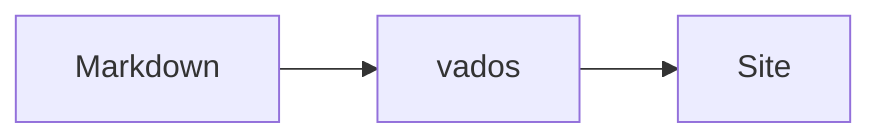

# Vados


source: [Dragon Ball Wiki](https://dragonball.fandom.com/wiki/Vados#Golden_Frieza_Saga)

## Introduction

This project will make it possible to quickly generate html files based on some file structure. It's main use case is to
make it simple to have a blog/log which can be easily maintained, having most of the content in markdown files. I create
this mainly to scratch my own itch and for learning. The scope can easily grow out of control, so I probably only add
things I would use myself. At this point it's much WIP, where braking changes can be expected. The name is based on that
it assumes [Bulma](https://bulma.io/) is assumed for the css. The generator is likely fast, and Bulma is also a
character in
[Dragon Ball Z](https://en.wikipedia.org/wiki/Dragon_Ball_Z). So I looked
for [fast Dragon Ball Z characters](https://www.cbr.com/dragon-ball-fastest-characters-ranked/) and thus ended up with
[Vados](https://dragonball.fandom.com/wiki/Vados). As it turns out she can also easily destroy and recreate planets,
which is kind of what this project does as well.

## Installation

vados is developed and tested on Linux. On Windows, use [WSL](https://learn.microsoft.com/windows/wsl/). macOS may work
but isn't tested.

Each [release](https://github.com/gklijs/vados/releases) has ready-made binaries for x86_64 and aarch64 Linux. They are
statically linked, so they run on any distribution. [cargo-binstall](https://github.com/cargo-bins/cargo-binstall)
finds them:

```
cargo binstall vados
```

Or download one yourself, check it and put `vados` on your `PATH`:

```
version=0.6.0   # the release you want
archive=vados-$version-x86_64-unknown-linux-musl.tar.gz
curl -sSfL -O https://github.com/gklijs/vados/releases/download/v$version/$archive \
  -O https://github.com/gklijs/vados/releases/download/v$version/$archive.sha256
sha256sum -c $archive.sha256 && tar -xzf $archive
```

To compile it instead, which needs a fairly recent stable Rust toolchain (see `rust-version` in `Cargo.toml`):

```
cargo install vados
```

## Getting started

`vados init` scaffolds a fresh, deployable project into the current directory: a `root/` source tree (`main.json`,
`menu.json`, a home `page.json`, an empty `static/` directory for [static files](#static-files-and-unlisted-pages)),
an `imgroot/` image tree, a Sass entry that loads Bulma with its `$primary` overridden, and a
`netlify.toml` that builds and deploys on Netlify with no further setup; its README also covers
[Cloudflare Pages](#hosting). It asks a few questions interactively (site title, home
intro, primary color, footer text, site language, an optional favicon file to copy in, an optional site URL, social handles) and refuses to run if anything it would create
already exists.

```
vados init
```

From there:

```
vados check --source root --img-source imgroot                       # validate before publishing
vados generate --source root --img-source imgroot --destination public  # publish the site
```

## Commands

Run `vados <command> --help` (or `vados <command> <subcommand> --help`) for the full flag list; this is a summary.

### `generate`

Reads the source and image trees and publishes a complete site to `--destination`.

```
vados generate --source root --img-source imgroot --destination public
```

Before writing, generation checks the source and reads every configuration file. Invalid JSON, unreadable source
folders, unsupported content references and incomplete menu or social entries fail with file-specific diagnostics,
leaving an existing destination untouched. Unreadable or malformed image manifests and missing image source files also
fail; an image that cannot be decoded or processed fails during publication. Invalid events and Luma events are
omitted with warnings, which are counted at the end. Other tolerated source problems are warnings too.

Output creation, writing and cleanup failures exit non-zero. An I/O or image-processing failure during publication
can leave partial output; fix the reported problem and run generation again. The output manifest advances only after
a complete run.

The library's `generator::generate` returns `Result<GenerateReport, GenerateError>`; the report contains the warnings,
and the error contains the findings that prevented publication.

`--check-links` also runs the [link check](#checking-links) on the result, and fails if it finds anything broken;
`--external` adds other sites to it, as warnings.

### `check`

Reads the same trees as `generate` and reports every problem it can find -- unreadable files, dangling content or
image references, incomplete social links, and so on -- without writing anything. Exits non-zero iff at least one
error-severity finding turned up; warnings are reported but never fail the check. Safe (and fast) to run on every
save.

Unknown JSON keys are warnings, including nested keys, with a close-name suggestion where possible.
Authoring commands refuse to rewrite a file containing unknown keys, so your data is not silently lost.
There are no exemptions for `_` or `x-` keys. In `main.json`, omitted `jsFiles` and `cssFiles` default to empty lists.

```
vados check --source root --img-source imgroot
```

`--output public` also runs the [link check](#checking-links) on a site already generated there; `--external` adds
other sites to it.

### Authoring content into an existing project

These subcommands change one piece of an already-scaffolded project at a time, instead of reading it wholesale the way
`generate`/`check` do. Each one checks itself against the same problems `check` would find before writing anything.
Any flag left unset is asked for interactively (a plain terminal prompt); a required piece with no terminal available
fails fast with a clear message instead of hanging.

- **`vados page new --source root --path /blog/my-post --title "My Post"`** -- creates a `page.json` for a path not
  yet in the source tree. `--content` names a `.md`/`.html` file or inline HTML; omitted, the page gets a bare
  `<h1>` heading. `--image` attaches an already-declared image as the hero, given `--img-source` to resolve it
  against. `--date 2026-10-22` (or `2026-10-22T09:30`) sets its publication date; under a parent ordered by date
  (see [Blogs and dated pages](#blogs-and-dated-pages)) it defaults to today. `--child-order date-desc` (or
  `date-asc`, or `order`, the default) sets how the new page lists its own children -- e.g. for a new blog section.
- **`vados image add --img-source imgroot --dir team --file-name alice.jpg --alt-text "Alice smiling"`** -- registers
  one image in an `images.json`, creating the file if the directory has none yet. `--alt-text` is required; images
  without it fail `check`.
- **`vados page add-image --source root --img-source imgroot --path /blog/my-post --existing-reference /team/alice`**
  -- attaches an image (freshly registered via `--dir`/`--file-name`, or already declared via
  `--existing-reference`) to a page. The first image attached to a page becomes its hero; every one after becomes a
  notification, unless `--as hero`/`--as notification` overrides that.
- **`vados social add --source root --provider github --handle gklijs`** -- adds a social link, named either by
  `--provider`/`--handle` for a recognised provider (see below) or by `--url`
  (plus `--icon`/`--brand-color`/`--label` for one vados doesn't recognise automatically -- `--label` is the link's
  accessible name, since it's rendered as an icon with no visible text). `--brand-color` (hex, with or without `#`)
  also overrides a recognised provider's own color, for example to show every icon in white on a dark navbar.
  `--provider mastodon --handle you@instance` adds a Mastodon link with its icon, color and label filled in.
  Supported providers: github, linkedin, facebook, youtube, twitter (X), bluesky, instagram, threads, tiktok,
  twitch, discord, reddit, gitlab, codeberg, stackoverflow, medium, spotify, soundcloud, vimeo, pinterest,
  telegram, whatsapp, signal and email. The init wizard offers these too. A URL alone is enough, for example
  `vados social add --source root --url https://bsky.app/profile/you.bsky.social` or
  `--url mailto:you@example.com`. Web links are recognised by their exact host, with or without `www.`,
  regardless of the path; a shared `/@you` path on an unknown host doesn't identify a provider.
  For `--handle`, omit a leading `@` (the provider's profile URL adds it where needed). Use a Discord user ID,
  Stack Overflow user ID, Spotify user ID, WhatsApp international phone number (digits only), Signal share-link
  token (the part after `#eu/`), or a full email address. For Discord invitations and Signal phone-number links,
  supply the complete `--url` instead. Self-hosted GitLab and other hosts still need custom metadata.
  Existing custom links to the new providers keep their explicit icon, colour and accessible name; missing
  fields get provider defaults. The original five providers keep their canonical icon and name.
- **`vados social update --source root --match github --url https://github.com/newhandle`** -- replaces an existing
  social link wholesale (same naming rules as `add`). `--match` is a substring of the existing link's url; `--index`
  disambiguates when more than one matches.
- **`vados social remove --source root --match github`** -- removes an existing social link.
- **`vados footer set --source root --content footer.md`** -- replaces the site-wide footer's content reference.
- **`vados menu add-item --source root --url /blog`** -- appends one entry to the main menu. `--title` is required
  for an external (`https://`) url; an internal one falls back to its target page's own title.
- **`vados menu remove-item --source root --match /blog`** -- removes a main-menu entry selected by a URL
  substring. When several match, `--index` selects one by its zero-based index among the matches.
- **`vados menu update-item --source root --match /blog --title News --position 0`** -- updates supplied
  `--url`, `--title` or `--icon` fields, keeping omitted fields. `--clear-title` restores an internal link's
  page title; `--clear-icon` removes its icon. `--position` moves the entry to a zero-based final position
  in the full menu. Selection uses the same `--match`/`--index` rules as removal. Invalid edits leave the file untouched.
- **`vados page add-luma-event --source root --path /events --event-id evt-AbC123 --title "Spring jam"`** -- links
  an event hosted on [Luma](https://luma.com) to a page; see [Luma events](#luma-events). `--display` picks
  `event-page` (the default), `register-button` or `both`; `--button-label` changes the button's text (default
  "Register", in the site's language). `--start`, `--end` and `--time-zone` say when it is, so that
  [agendas](#events) can list it.
- **`vados page enable-feed --source root --path /blog`** -- publishes an Atom feed of a page's dated children; see
  [Feeds](#feeds). `--title` and `--limit` set the feed's title and size. A feed needs the site's address, so when
  `main.json` has no `siteUrl` yet, `--site-url https://example.com` is required (or asked for) and written there.
  `--from`, `--depth`, `--include-unlisted` and `--summaries-only` choose its entries.
- **`vados page set-event --source root --path /agenda/jam --start 2026-11-05T14:00:00+01:00 --time-zone Europe/Amsterdam`**
  -- makes a page an event; see [Events](#events). Takes `--end`, `--attendance`, `--status`, `--venue`, `--address`,
  `--organiser`, `--cost`, `--registration-url` and `--virtual-url`, and replaces any event the page has. An invalid
  event is refused. Changing an event raises its calendar `sequence`, unless `--sequence` sets it.
- **`vados page enable-agenda --source root --path /agenda`** -- lists events on a page. `--from`, `--depth` and
  `--include-unlisted` choose which.
- **`vados page set-noindex --source root --path /check-your-email`** -- keeps a page out of search results and the
  sitemap; `--off` undoes it.
- **`vados search enable --source root`** -- publishes a [site search](#site-search). Takes `--from`, `--depth`,
  `--include-unlisted` and `--no-menu`.
- **`vados spare-tile set --source root --title "More" --link "/topics=All topics" --link "/feed.xml=Subscribe"`** --
  sets the block of links (each `--link` splits at its last `=`) for [spare cells](#bulma-and-dark-mode); `vados spare-tile remove --source root` removes it.
- **`vados navbar set --source root --theme dark --dropdown-limit 8`** -- sets `navbarTheme` and `menuDropdownLimit`;
  see [The navbar](#the-navbar).

## Project layout

A vados project is two plain-text trees plus generated output:

- **Source tree** (`--source`): `main.json` (site title, footer, extra CSS/JS, background, navbar color, language,
  description, favicon, site URL) and `menu.json` (main menu, social links) at the root, and one `page.json` per content directory. Every directory
  under the root is a page, whether or not it has its own `page.json` -- one without gets a title from its directory
  name and a placeholder paragraph for content.
- **Image tree** (`--img-source`): one `images.json` per directory of images to publish. Each declared image is
  centre-cropped to the closest standard aspect ratio and published as a set of responsively sized WebP variants.
  A page's hero image is fetched first (`fetchpriority="high"`), and the first row of its tile images eagerly; the
  rest load lazily.
- **Destination** (`--destination`, `generate` only): the published site. Image variants are reused only when the
  source bytes and processing settings match and every variant is present. Replacing an image under the same name
  regenerates its WebP variants and link-preview crop. Unchanged images skip decoding; keep `.vados-images/`
  between builds for this cache (deleting it safely forces regeneration). Image URLs stay the same, so browser
  caching still depends on your host. Each completed run records its output (including reused images) in
  `.vados-manifest.json` inside the destination. The next run removes previously recorded files it no longer needs
  and directories left empty, including removed pages, static files and disabled features. Files from other build
  steps, such as compiled CSS, are preserved. With no previous manifest, nothing is deleted; output left by older
  vados versions needs a one-time manual cleanup. Keep the manifest between builds; it contains only relative output
  paths, and can be excluded from deployment if your host serves dotfiles.

## Editor support

vados publishes a [JSON Schema](https://json-schema.org/) for `main.json`, `menu.json`, `page.json` and `images.json`
in [`schemas/`](schemas). Editors that understand JSON Schema (VS Code, the JetBrains IDEs, Zed, Neovim with a JSON
language server) then complete keys, show what each one does, and flag a misspelt key, a wrong type or a value like
`"childOrder": "datedesc"` while you type. They also check the form of dates, event times, Luma event IDs and
social link colours.

A file finds its schema through `"$schema"`, its first key:

```json
"$schema": "https://raw.githubusercontent.com/gklijs/vados/v<version>/schemas/page.schema.json"
```

with `<version>` being what `vados --version` says, such as `0.6.0`. Schemas are published from the first release
that includes them.

`vados init` writes it into every file it creates, and so do `page new` and `image add`, pointing at the schemas of
the vados version that ran. The other authoring commands keep it when they rewrite a file. Add it by hand to files
created before, and change the version in it after upgrading vados, so new keys aren't flagged. vados itself ignores
`$schema`: `check` and `generate` don't need it, and `check` keeps its own findings and messages.

## Luma events

A page can show events hosted on [Luma](https://luma.com) in its main area, right after its own content. Each one is
listed under `lumaEvents` in the page's `page.json`; most pages link one, but any number is fine:

```json
"lumaEvents": [
  { "eventId": "evt-AbC123", "title": "Spring jam", "display": "both", "buttonLabel": "Sign up" }
]
```

- `eventId` is Luma's event ID (`evt-...`), shown in the event's embed options on Luma.
- `title` is required: it's the text of a plain link to the event on Luma, always shown, and the accessible name of
  the embedded event page.
- `display` is `eventPage` (Luma's embedded event page, which includes registration -- the default),
  `registerButton` (a button opening Luma's registration over the page), or `both`.
- `buttonLabel` is the register button's text, defaulting to "Register" in the site's language.

An event is shown only on the page that lists it, not on pages beneath it. Luma's button script is loaded only on
pages that show a register button; pages without a Luma event make no requests to Luma. `check` reports an event
ID that isn't of the form `evt-...` or an event without a title as errors (`generate` leaves such an event off the
page), and the same event listed twice on one page as a warning. Nothing is fetched from Luma by `check` or
`generate`, so whether the event actually exists isn't checked.

An event can also say when it happens, with `start`, `end` and `timeZone` read the same way as a page's
[`event`](#events). Those are typed by hand, since nothing is fetched from Luma, and they only matter to agendas and
calendars: an event without them is shown on its page as usual and stays out of those.

Luma support hasn't been tried against a real event yet. Its addresses come from Luma's documentation, and they're
all in `src/luma.rs`. If an embed or button doesn't work, please compare them with what the event's Embed tab gives you.

## Blogs and dated pages

A page can carry a publication date in its `page.json`, and a section can list its pages by that date instead of by
`order`, so a new post appears first without renumbering anything:

```jsonc
// blog/page.json
{ "title": "Blog", "content": "posts.md", "childOrder": "dateDesc" }

// blog/my-post/page.json
{ "title": "My post", "content": "post.md", "date": "2026-10-22" }
```

- `date` is `YYYY-MM-DD`, optionally with a time (`2026-10-22T09:30`) to order posts published the same day. It's
  shown under the page's title and on the tiles advertising it, written the way the site's language writes dates
  (`22 October 2026`, `22 oktober 2026`, ...).
- `childOrder` is `order` (the default: by `order`, then title), `dateDesc` (newest first) or `dateAsc` (oldest
  first). It applies wherever the section's pages are listed: the main menu dropdown, the side menu and the side
  tiles. Undated pages come after the dated ones; pages with the same date fall back to `order`, then title.
- In a `dateDesc` section, the side tiles show the newest pages.

A page can also show the newest dated pages from elsewhere -- a home page showing the blog's latest posts, at any
depth below it (`/blog/2026/my-post`):

```json
"latest": { "from": "/blog", "limit": 4, "depth": 2 }
```

`from` is a path or a list of them; `limit` defaults to 4, and `depth` (how many levels below `from` to look) to any.
They're shown as tiles with their date, summary and image, newest first, before the page's own notifications. `check`
warns about a `from` that matches no page.

`vados page new --path /blog --title Blog --child-order date-desc` creates such a section; every `page new` beneath it
then gets today's date unless `--date` says otherwise.

`check` reports a `date` it can't read as an error (`generate` treats that page as undated), and an undated page
under a parent ordered by date as a warning.

## Feeds

A page can publish an [Atom](https://en.wikipedia.org/wiki/Atom_(web_standard)) feed of its dated children, so
readers can subscribe to a blog or news section:

```jsonc
// main.json
"siteUrl": "https://example.com"

// blog/page.json
{ "title": "Blog", "content": "posts.md", "childOrder": "dateDesc", "feed": true }
```

- `feed` is `true`, or `{ "title": "My blog", "limit": 10 }` to name the feed (default: the site title plus the
  page's) and cap its size (default 20). It's published at the page's path plus `/feed.xml`, e.g. `/blog/feed.xml`,
  or `/feed.xml` for the home page.
- It lists the page's children that have a `date`, newest first whatever their `childOrder`, each with its title,
  `summary` and full content. A feed has no time zone to go by, so dates are given as UTC.
- `siteUrl` is required: a feed is read away from the site, so every link in it is given in full. Without a usable
  one, `generate` publishes the site without feeds.
- Every page of the section links the feed in its `<head>`, where feed readers look for it, and the section's own
  page shows a "Subscribe" link in the site's language.

A feed can also draw from elsewhere, the way [`latest`](#blogs-and-dated-pages) does, for content that is nested or
unlisted:

```json
"feed": { "from": "/i", "depth": 1, "limit": 50, "includeUnlisted": true, "content": "summary" }
```

- `from` is a path or a list of them, and `depth` how many levels below it to look: any depth when `from` is given,
  and only direct children when it isn't.
- `includeUnlisted` takes pages with `"listed": false` too, which are otherwise left out of feeds.
- `content` is `full` (the default) or `summary`, for entries that carry only their `summary`. A page without one keeps
  its full content, since an entry needs one or the other.

`check` reports a feed without a usable `siteUrl`, and a `siteUrl` that isn't an absolute http(s) URL, as errors. It
warns about a feed with no entries, a `from` that matches no page and, for a feed of its own children, an undated page
it leaves out.

## Search engines and browser tabs

Two optional `main.json` settings describe the site to search engines and browsers:

```json
"description": "A short description of the site, shown by search engines.",
"favicon": "favicon.svg"
```

- `description` becomes every page's `<meta name="description">` (and link-preview description), except on a page
  with a `summary` of its own in its `page.json`, which describes that page instead.
- Every page's `<title>` is its own title followed by the site title (`My post · My site`), so browser tabs and
  search results say whose site it is; the home page's is just the site title. `titleSeparator` changes the ` · `
  in between. Link previews get the bare page title, plus the site title as `og:site_name`.
- Link previews (LinkedIn, Mastodon, Slack, X, ...) get the page's type (`article` for a dated page), language and,
  with a `siteUrl`, its canonical URL and an image: the page's hero `image`, or else `main.json`'s `defaultImage`
  (an image reference, like a page's). vados publishes a 1200×630 JPEG crop of every image used this way next to its
  WebP variants (e.g. `/img/photos/batman-og.jpg`), since LinkedIn doesn't reliably show WebP. `check` warns when
  pages have images but there's no `siteUrl` to point previews at them.
- Every dated page carries [schema.org](https://schema.org/BlogPosting) structured data for search engines: a
  `BlogPosting` with its title, `summary`, date, preview image and author; the home page describes the site and its
  author. The author is `main.json`'s `"author": { "name": "...", "url": "..." }` (both optional, defaulting to the
  site title and home page), with the social links as their other profiles. A page's optional `updated` date (same
  form as `date`) becomes its modified date there and in feeds. `check` warns about a dated page without a `summary`.
- Social links carry `rel="me"`, so Mastodon can verify the site as yours (the green checkmark on your profile).
  Every page also names your fediverse handle as `fediverse:creator`, which Mastodon shows as the author under link
  previews: `main.json`'s `"fediverseCreator": "@you@instance"`, or else taken from a social link with the
  `mastodon` icon. `vados social add --source root --provider mastodon --handle you@hachyderm.io` adds such a link.
- `favicon` is a file in the source root -- SVG, PNG or ICO -- published at the site root and linked as every
  page's icon. `vados init` asks for one (leave it blank to skip). `check` warns when the file is missing; `generate` then publishes the site without an icon.

## Sitemap

With a `siteUrl`, vados publishes `/sitemap.xml`, listing every page (except unlisted ones) by its full address, to
submit in Google Search Console or Bing Webmaster Tools. A page's `<lastmod>` is its `updated` date, or else its
`date`; pages with neither get none, since search engines distrust a date that just records the build.

A `/robots.txt` allowing all crawlers is always published, so crawlers never get a 404 for it. With a `siteUrl` it
also names the sitemap. A `robots.txt` in the static directory replaces it.

## Static files and unlisted pages

Files a site needs at a fixed address -- `robots.txt`, search engine verification files, `.well-known/...`,
[`_headers`/`_redirects`](#hosting), downloads -- go in a static directory, named in `main.json`:

```json
"staticDir": "static"
```

Everything in it is published as it is, at the same path under the site root (`static/.well-known/security.txt`
becomes `/.well-known/security.txt`). The path is relative to the source root; a directory inside it isn't a page.
Pages are written after static files, so a page at the same path replaces one; `check` warns about that, and about a
`staticDir` that doesn't exist. A `.gitkeep` is never published, so it can keep an empty static directory in git;
`vados init` scaffolds `root/static/` with one and sets `staticDir` for you.

A page with `"listed": false` in its `page.json` is published in the site's layout but listed nowhere: not in menus,
side tiles, feeds or the sitemap. Search engines can still find it if something links to it.

`"noindex": true` is the opposite question: it writes `<meta name="robots" content="noindex, follow">` and leaves the
page out of the sitemap and the [site search](#site-search). That suits confirmation pages and lists not worth showing
in search results. `check` warns about a noindexed page that is still listed, which is sometimes what you want and
sometimes a mistake. The two combine for a 404 page: `root/404/page.json` with `"listed": false, "noindex": true`
publishes `404.html`, which Netlify, GitHub Pages and Cloudflare Pages serve for unknown paths. Links in it must start
with `/`, since it's served at any depth.

## Bulma and dark mode

Pages are styled with [Bulma](https://bulma.io/) 1.0, by default loaded from jsDelivr. Bulma follows the reader's
colour-scheme preference, so pages show its dark theme to readers who prefer one, and so does the default background
(`has-background-light-soft`). Colours a site chooses -- the navbar, notification colours, brand colours of social
icons -- stay as chosen in both themes. What sits on a chosen colour follows that colour instead of the reader's
scheme (Bulma's `theme-light` on a light colour, `theme-dark` on a dark one), so a heading in a yellow notification
stays dark, and a yellow navbar's menus stay light. A brand colour that is hard to see on the navbar can be overridden
with `color` in `menu.json` or `--brand-color` when adding/updating the link. No brand colour is readable on
every navbar: black logos (Threads, TikTok, Medium and email) disappear on a black navbar, while bright logos
(such as Spotify and WhatsApp) need a darker override on a white navbar. Check the chosen colours together;
use white (`ffffff`) on Black/Dark/Link navbars and black (`000000`) on the other default Bulma navbar colours.
Custom stylesheets may need different overrides.

A page's own content sits in Bulma columns, with its left and right notifications in a two-column Bulma grid below it,
read row by row; on a phone they stack in that same order. Side by side the tiles grow to end with a taller side
column. When one column has more tiles, the cells the other is missing can hold a block of links, such as an archive,
topics or a way to subscribe:

```json
"spareTile": { "title": "More to read", "links": [{ "url": "/topics", "title": "All topics" }] }
```

It's shown on a tablet and wider, since tiles stack on a phone and leave no cell over, and needs no script. `check`
warns about a link to a page that doesn't exist. Without one, the shorter column's last tile stretches down alongside
the longer one, unless it has an image: then the stretch would look like a large empty block, so the cell stays empty. With
`"stretchSideNotification": true` in `main.json` the last side notification also grows to end with the page's content;
without it, side notifications keep their own height. A site that sets its own `cssFiles`, or compiles Bulma through
`package.json`, must use Bulma 1.0 or later: Bulma 0.9's tiles are no longer used, and `check` fails on a stylesheet
or dependency still on Bulma 0.x. After bumping `package.json`, run `npm run build` to rewrite the compiled CSS.

A site with a fixed palette, which isn't meant to change with the reader's preference, can opt out: `"colorScheme":
"light"` (or `"dark"`) in `main.json` pins every page to that Bulma theme with `data-theme` on `<html>`. Colours chosen
for notifications and the navbar keep their own theme either way. The theme a chosen colour carries is based on Bulma's
default colours (a light `warning` and `info`, a dark `link`), so a site that recolours these to something of the
opposite brightness gets the wrong hint on that colour and needs CSS of its own for what sits on it.

### Moving an existing site to Bulma 1.0

1. Set `"bulma": "^1.0.4"` in `package.json` and run `npm install`.
2. In `sass/main.scss`, replace `$primary: ...; @import "bulma/bulma";` by
   `@use "bulma/sass" with ($primary: ...);`. Bulma's variables are given as it is loaded now; `@import` still works
   but is deprecated. In `package.json`, build with `sass --load-path=node_modules --quiet-deps ...`.
3. Check the other variables you set. Bulma 1.0 has no `$colors` map: the named colours are `$primary`, `$link`, `$info`,
   `$success`, `$warning` and `$danger`, and `$custom-colors` adds more. Bulma's own defaults for `$link` and the
   others now apply where the old stylesheet left them out, so a tile in a colour you never styled may now show one.
   `$footer-background-color` and the other footer variables still exist, but default to colours that follow the colour
   scheme; set `--bulma-footer-background-color` in CSS to colour the footer in both.
4. Drop CSS that was written for Bulma 0.9's tiles or for vados's old mobile layout: anything on `.tile`, `.is-ancestor`,
   `.is-parent`, `#child-tiles-left`, `#child-tiles-right`, or an inline `order` on `#sub-l-*`/`#sub-r-*`. vados no
   longer emits them.
5. Run `npm run build`, then `vados check`: it fails while `cssFiles` or `package.json` still name Bulma 0.x, and warns
   about an `@import` of Bulma left in `sass/main.scss`.
6. Look at dark mode, or pin the site with `colorScheme`. Your own `$title-color` or other colour overrides apply in
   both themes.

### Compiling only what vados needs

A site that compiles its own stylesheet can load just the parts of Bulma that vados's templates use, instead of all of
it. This is the complete list; a test keeps it in step with the templates, so check it again when you upgrade vados:

```scss
@use "bulma/sass/base";
@use "bulma/sass/themes";
@use "bulma/sass/components/breadcrumb";
@use "bulma/sass/components/menu";
@use "bulma/sass/components/navbar";
@use "bulma/sass/elements/block";
@use "bulma/sass/elements/box";
@use "bulma/sass/elements/button";
@use "bulma/sass/elements/content";
@use "bulma/sass/elements/icon";
@use "bulma/sass/elements/image";
@use "bulma/sass/elements/notification";
@use "bulma/sass/elements/title";
@use "bulma/sass/form/shared";          // these three only for the site search
@use "bulma/sass/form/input-textarea";
@use "bulma/sass/form/tools";
@use "bulma/sass/grid/columns";
@use "bulma/sass/grid/grid";
@use "bulma/sass/helpers/color";
@use "bulma/sass/helpers/flexbox";
@use "bulma/sass/helpers/gap";
@use "bulma/sass/helpers/spacing";
@use "bulma/sass/helpers/typography";
@use "bulma/sass/helpers/visibility";
@use "bulma/sass/layout/container";
@use "bulma/sass/layout/footer";
@use "bulma/sass/layout/section";
```

Give your colours to the first one that takes them, for example `@use "bulma/sass/utilities" with ($primary: #00796b);`
before this list. Classes your own content uses need their modules added too.

## The navbar

A main menu entry with children has a normal link to its page, plus a button that opens the list of its children. The
button follows the [disclosure navigation pattern](https://www.w3.org/WAI/ARIA/apg/patterns/disclosure/examples/disclosure-navigation/):
opening one list closes the others, `Escape` closes it and returns focus to the button, and it closes when focus leaves
it or on a click elsewhere. `Escape` also closes the burger menu. Without JavaScript the button stays hidden and
hovering or focusing opens the list. `"includeDefaultJs": false` leaves that script out, so a site doing this needs its
own.

No menu item is ever out of reach. A menu too wide for its bar wraps onto a second line, and the page moves down to stay
clear of the taller bar (that part needs the script). Open lists stay on the screen and scroll when long. A dropdown
lists up to 12 children, newest first in a section ordered by date, then ends in a link to the section;
`"menuDropdownLimit"` in `main.json` changes the number. Pages not shown there stay listed everywhere else.

Bulma's burger breakpoint, 1024px by default, is compiled into its stylesheet, so `main.json` can't set it. A long menu
that looks better with a burger on a small laptop can raise it where Bulma is loaded:
`@use "bulma/sass/components/navbar" with ($navbar-breakpoint: 1216px);`. vados's own rules follow whichever one you
compile.

The bar's text follows its colour, and the page you're on is marked by a bottom line and heavier text. With Bulma's
default colours every `navbarColor` reaches at least 4.5:1, in both colour schemes. A stylesheet that recolours the bar
can set these custom properties, with no need for selectors that depend on vados's markup:

| Property | What it colours | Default |
| --- | --- | --- |
| `--vados-nav-bg` | the bar and the open burger menu | Bulma's colour for `navbarColor` |
| `--vados-nav-ink` | text, icons, the burger and the dropdown buttons | what Bulma pairs with that colour |
| `--vados-nav-accent` | the line under the current and hovered item | the ink |
| `--vados-nav-hover` | the background of a hovered item | none |
| `--vados-nav-dropdown-bg` | an open list | Bulma's surface for the theme |
| `--vados-nav-dropdown-ink` | text in an open list | Bulma's strong text colour |

```css
:root { --vados-nav-bg: #4a1d96; --vados-nav-ink: #fff; }
```

vados can't see a colour compiled into your stylesheet, so when you make `$warning` deep violet, say which theme belongs
on it with `"navbarTheme": "dark"` in `main.json` (or `"light"`). Without it, the theme comes from the colour's default
brightness in Bulma. Set the properties on `:root` or `#nav-bar`. vados's inline style comes before your stylesheets, so
a rule of your own with the same weight wins.

## Site search

`"search": true` in `main.json` publishes a working search at `/search`, in the site's language, with an entry in the
main menu. It makes no outside requests, and needs only `connect-src 'self'` under a strict Content-Security-Policy.

```json
"search": { "from": ["/blog", "/agenda"], "depth": 2, "includeUnlisted": true, "menu": false }
```

- `from` limits it to pages below these, `depth` to so many levels down, and `includeUnlisted` also takes pages with
  `"listed": false`. Without them it covers every listed page. Pages with `"noindex": true` are always left out.
- `menu: false` leaves it out of the main menu. A menu entry of your own for `/search` keeps its place.
- A `root/search/page.json` of your own gives the page its title and text; the search goes below them. The page vados
  makes when you have none has `noindex`.
- The index, `/search-index.json`, holds each page's title, address, date, section and `summary`, or else the start of
  its text. It's only downloaded once someone searches. A failed download can be tried again.
- Every word must match, ignoring accents and case, so "cafe" finds "Café". Title matches come first, then the newest.
- The page says so when there's no JavaScript, and results are announced to screen readers.

## Events

A page becomes an event with `event` in its `page.json`:

```json
"event": {
  "start": "2026-11-05T14:00:00-05:00",
  "end": "2026-11-05T15:30:00-05:00",
  "timeZone": "America/New_York",
  "attendance": "online",
  "status": "scheduled",
  "organiser": "Community group",
  "venue": "Online",
  "address": null,
  "cost": null,
  "registrationUrl": "https://example.com/register",
  "virtualUrl": null,
  "sequence": 0
}
```

Only `start` and `timeZone` are required. `attendance` is `online`, `inPerson` or `mixed`; `status` is `scheduled`,
`cancelled`, `postponed` or `rescheduled`.

- **Nothing is made up.** A detail left out shows as "not confirmed" and is left out of structured data and calendar
  files. No `cost` never means free, and no `virtualUrl` is taken from a registration link.
- **Times are checked strictly.** `start` and `end` need a UTC offset, and must be what `timeZone` really shows at that
  moment. That catches a winter offset in summer and a time a clock change skips, while either occurrence of a repeated
  autumn hour stays valid. An invalid event, including one that's missing a field or has a misspelt status, is an error
  in `check`, and `generate` leaves it off the page and publishes the rest.
- **Search engines** get schema.org `Event` data instead of `BlogPosting`. Its identity is the page's address plus
  `#event`, so keep the path when you reschedule or cancel.
- **Calendars:** with a `siteUrl`, each event gets a calendar file next to its page, `/agenda/jam.ics`, linked from the
  page. Raise `sequence` whenever an event changes, so subscribers take the change; `vados page set-event` does that for
  you. Serve `.ics` files as `text/calendar`, with short caching. `check` warns about events without a `siteUrl`.

A page can list events with `"agenda": true`, or `{ "from": "/events", "depth": 1, "includeUnlisted": true }`. Without
`from` it takes those below it. They're listed soonest first, and with a `siteUrl` also published as a subscribable
`calendar.ics`. [Luma events](#luma-events) that say when they are join in, linking to Luma: those on the selected pages,
and those on the agenda's own page, whatever `from` says. To keep one of its own out, leave off its `start` and
`timeZone`. Every event is in the page, and a small script hides those that have ended, with a button to show them
again, so a page cached for days stays right. Without JavaScript all of them stay visible.

## Markdown versions

Set `"markdown": true` in `main.json` to publish a Markdown alternate alongside
every HTML page. The homepage gets `/index.md`; `/blog/post` gets `/blog/post.md`.
Each HTML page links its alternate with `rel="alternate"` and `type="text/markdown"`.
This is off by default and needs no `siteUrl`; with one, the Markdown includes
the full canonical HTML URL, otherwise the site-root path.

Markdown versions contain the title, subtitle, dates, hero image, page content,
child listings, notifications, latest posts, event details, agendas and Luma links.
Navigation, footer, forms, scripts and embedded frames are omitted. Authored
Markdown keeps its formatting; HTML content becomes readable Markdown. Relative
links and image URLs resolve against the original HTML page URL, including
fragment links, so their targets remain the same. Page links continue to use HTML.

Unlisted and `noindex` pages also get alternates: these settings control discovery,
not access. A Markdown alternate does not carry HTML's robots meta tag; apply an
`X-Robots-Tag: noindex` hosting header to its `.md` URL if it must stay out of
search results. Markdown alternates are not added to the XML sitemap.

Generated Markdown replaces static files at the same path, which `vados check`
reports. Configure your host to serve `.md` as `text/markdown; charset=utf-8`.
For example, in a Netlify or Cloudflare Pages `_headers` file:

```
/*.md
  Content-Type: text/markdown; charset=utf-8
```

`/llms.txt` is not generated.

## Checking links

`vados check --output public` or `vados generate --check-links` check the generated site itself, which catches what
source checks can't, such as mistakes in hand-written HTML:

- links to pages on the site, including absolute ones using `siteUrl`, resolved the way hosts do (`/agenda` is
  `agenda.html`, even with an `agenda/` directory next to it)
- `#fragments`, which must exist as an `id` on the target page
- images and `srcset` entries, stylesheets and scripts, and files named by `url()` in CSS
- every address in `sitemap.xml`

Problems are errors, naming the page and the target. Other sites aren't contacted unless you ask, because their
availability shouldn't block a build. A directory that can't be read is an error, so a mistyped path doesn't pass.

`--external` asks them too, each site one request at a time. Problems are only ever warnings, and only a clear "not
there" (404, 410) or no answer at all counts, since many sites refuse anything that isn't a browser. Addresses on private
networks are skipped, also through a redirect, so that content can't make your machine call its own network. Building vados
with `--no-default-features --features highlight` leaves this out, along with its HTTP client.

Plain `vados check` needs no build, and warns about links in your content to pages that don't exist. It only looks at
addresses starting with `/` without a file extension, since a file could be something `generate` writes, and it knows
your static files.

## Hosting

`generate` writes plain files, so any static host can serve them. These are the two vados sites run on.

**Cloudflare Pages:** build wherever you like and upload the result:

```
npx wrangler login
npx wrangler pages project create my-site --production-branch main
vados generate --source root --img-source imgroot --destination public --check-links
npx wrangler pages deploy public --project-name my-site
```

Pages rather than Workers static assets suits a domain whose DNS isn't on Cloudflare, since Workers custom domains need
Cloudflare-managed nameservers. Point a CNAME at the project's `pages.dev` address and add the domain under the project's
custom domains. If `pages project create` hands you over to Workers and fails, add `--force`.

**Netlify:** connect the repository. The `netlify.toml` from `vados init` downloads the vados release binary, checks it
against the release's checksum and builds the site. No Rust toolchain is installed. It uses the version set as
`VADOS_VERSION` in its `[build.environment]`, which is the version that scaffolded the site, so a new vados release
can't break a deploy. To upgrade, change that line. A site that installs vados with `cargo install` can switch to the
same download: copy the `command` and `VADOS_VERSION` from a freshly scaffolded `netlify.toml`.

Both serve `/agenda` from `agenda.html` and `/404.html` for a missing path, including nested ones, and read a `_headers`
and `_redirects` file from the site root. Put those in your static directory:

```
/*
  X-Content-Type-Options: nosniff

/agenda/*.ics
  Content-Type: text/calendar; charset=utf-8
  Cache-Control: no-cache
```

Some things to know, the first two of which `check` warns about, in the static directory and in `--output`:

- **No comment lines in `_headers`.** A `#` line made every request on Cloudflare Pages answer an empty 404 when we
  tested it on 2026-10-30.
- **A header value is limited to about 2,000 bytes** on Cloudflare, which a Content-Security-Policy listing many hashes
  can reach.
- **Rules combine rather than override** on Cloudflare Pages, so a general `Cache-Control` plus a specific one sends both.
- **A strict Content-Security-Policy needs hashes** of the inline `<style>` and any JSON-LD on each page. vados doesn't
  generate these: compute them from the built pages, in a step after `generate`, and rerun it whenever vados changes.
- **Calendar files need that `Content-Type`** for calendar apps to subscribe, which is what the example above is for.

## Code blocks

Fenced Markdown code blocks that name a language (```` ```rust ````, ```` ```python ````, ...) are highlighted when the
site is generated: no script, and they read the same without one. Blocks without a language, in one vados doesn't
know, or indented stay plain, as does inline code. The colours (GitHub's light theme, and base16 Ocean in Bulma's dark
theme, each adjusted where needed to stay readable on Bulma's code background in that theme) come from `/css/vados-highlight.css`, which only pages with highlighted code
load. `"codeHighlight": false` in `main.json` turns it off. Building vados with `--no-default-features` leaves the
highlighter out, about 1 MB of the binary.

## Diagrams

A fenced `mermaid` block in Markdown becomes a diagram in the reader's browser:

````markdown

````

Give each diagram an `accTitle` or `accDescr` (preferably both) so Mermaid can
label its SVG for assistive technology. See [Mermaid's accessibility syntax](https://mermaid.js.org/config/accessibility.html).
`vados check` warns about missing alternatives and empty diagrams. It doesn't
validate diagram syntax; an invalid diagram stays visible as source code.

Diagrams work in page content, Markdown notifications and the footer. Only pages
showing one load the loader and Mermaid. Without JavaScript, or if loading or
rendering fails, the source remains readable. Wide diagrams scroll within their
column. Mermaid follows the reader's light/dark preference, `colorScheme`, and a
notification's `.theme-light` or `.theme-dark`, and updates on preference changes.
Diagram colours use Mermaid's default and dark themes; authored colours and all
Mermaid diagram types are not covered by the code highlighter's 4.5:1 contrast
guarantee. Check the colours of your diagrams before publishing.

`"mermaid": false` in `main.json` leaves the blocks as ordinary code and makes
`check` warn that diagram rendering is disabled. This is independent of
`codeHighlight`. HTML content is left alone. Atom feeds keep ordinary Mermaid
code blocks, and Markdown alternates keep the diagram source.

By default, diagram pages import Mermaid **12.3.0** from jsDelivr. Visitors to those
pages make requests to that CDN, which receives their IP address. To self-host,
copy the Mermaid npm package's complete `dist` directory (including its chunks)
into `staticDir`, for example `root/static/vendor/mermaid`, then set:

```json
"mermaidScript": "/vendor/mermaid/mermaid.esm.min.mjs"
```

The override must be an absolute HTTP(S) module URL or a root-relative file path
that exists in `staticDir`; `check` reports invalid or missing paths as errors.
The module must export the Mermaid API as its default export. A strict
Content-Security-Policy needs `script-src` to allow the module and its chunks
(`'self'` when self-hosted, `https://cdn.jsdelivr.net` for the default), plus the
styles used by Mermaid's SVGs. The local loader is `/js/vados-mermaid.js`.
No Node.js or browser is needed to generate a site.

## Icons

Icons -- on menu entries (`icon` in `menu.json` and `page.json`), social links, breadcrumbs and the side menu -- are
[Material Design Icons](https://pictogrammers.com/library/mdi/) names (`home`, `github`, `rss`, ...), drawn inline as
SVG in the colour of the surrounding text, and `list` is short for `format-list-bulleted`. Pages load no icon font.
The bundled set also includes `bluesky`, `threads`, `tiktok`, `discord`, `codeberg`, `medium`, `telegram` and
`signal-messenger` from [Simple Icons](https://github.com/simple-icons/simple-icons) (CC0; see
[icon sources](assets/mdi/README.md)). `signal` itself remains MDI's signal-strength icon.
`check` warns about a name that isn't in the set,
suggesting close ones when there are any; that icon is then left out, with no gap where it would have been. Content that uses the font's own classes (`<span class="mdi mdi-github">`) needs its
stylesheet in `cssFiles`.

## Accessibility

Every published page declares the site's language (`main.json`'s `language`, defaulting to `en`) on its root
element, offers a skip-to-content link and marked-up navigation/main/footer landmarks, and gives every icon-only
control (social links, the menu toggles, the [dropdown buttons](#the-navbar)) an accessible name -- a social link's is
its provider's own name, or an explicit `--label` for one vados doesn't recognise. Every declared image requires alternative text; `check` flags
one that doesn't.

A page's title is its one `<h1>`, and the titles of its tiles and Luma events are `<h2>`s under it, so headings
outline the page for search engines and for screen-reader users jumping between headings. Start a page's own content
at `##` (or `<h2>`): `check` warns about a `#` heading or `<h1>` in it, since that would make a second one.

The text vados adds itself -- the skip link, the names of the navigation landmarks and menu toggles, event details, the
site search and a Luma register button's default label -- follows the site language. It's available in English, Dutch, German, French and
Spanish (matched on the language alone, so `nl-BE` gets Dutch); for any other language it falls back to English and
`check` warns about it.

## Developing vados

`cargo test` covers everything that doesn't need a browser. `tests/browser` drives real Chromium over generated sites
for layout, keyboard use, scripts and colours, compiling its stylesheet from the [module list](#compiling-only-what-vados-needs):

```
cargo build
cd tests/browser
npm ci
npx playwright-core install chromium   # or set BROWSER_PATH to a browser you have
npm test
```

After changing a configuration struct or its doc comments, which become the schemas' descriptions, rewrite `schemas/`
with `VADOS_UPDATE_SCHEMAS=1 cargo test --lib schemas`; without it, that test fails while they're out of date.

Dependabot opens weekly pull requests for the Rust crates, the browser tests' npm packages and the GitHub Actions,
one grouped pull request per ecosystem for minor and patch updates and a separate one for each major update. A Bulma
update runs the browser tests against the module list above; a new Bulma minor or major may need that list updated.
The audit workflow runs `cargo deny check advisories licenses` weekly and whenever `Cargo.lock`, `Cargo.toml` or
`deny.toml` changes: it fails on a RustSec advisory or on a dependency licence missing from `deny.toml`'s allow-list.
Run the same command locally after `cargo install cargo-deny`.

To release, set the new `version` in `Cargo.toml`, rename the changelog's "Unreleased" heading to
`## <version> - <date>`, and push a `v<version>` tag. The release workflow checks the tag against `Cargo.toml`, builds
and tests the Linux binaries, and publishes them with that changelog section as the release notes. A version such as
`0.6.0-rc.1` becomes a pre-release, using "Unreleased" if it has no section of its own. Publishing to crates.io stays
a manual `cargo publish`.

## Examples

A website where I share my adventures mastering bass playing serves as example. The site itself is hosted
via [Netlify](https://www.netlify.com/) and can be found [here](https://bass.gklijs.tech). The source code for the
website can be found on [Github](https://github.com/gklijs/vados_bass)

## License

This project is licensed under MIT license ([LICENSE-MIT](LICENSE-MIT) or (http://opensource.org/licenses/MIT)

### Contribution

Unless you explicitly state otherwise, any contribution intentionally submitted for inclusion in Vados by you shall be
MIT licensed as above, without any additional terms or conditions.
